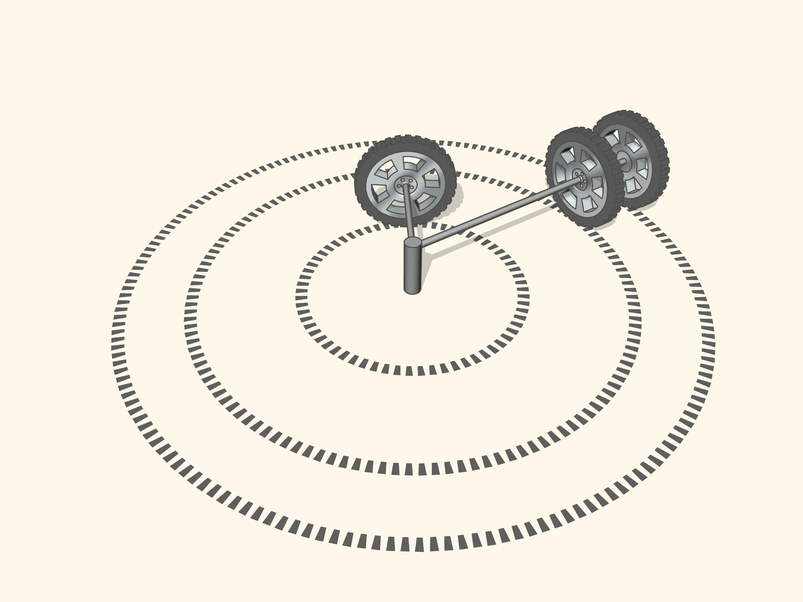
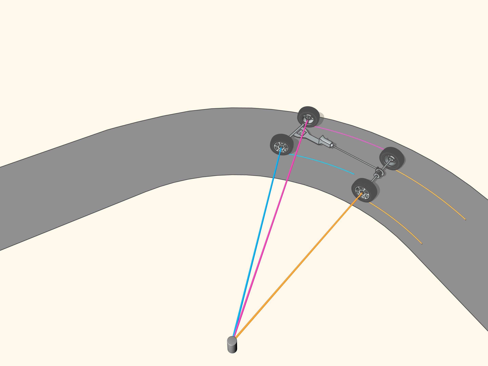
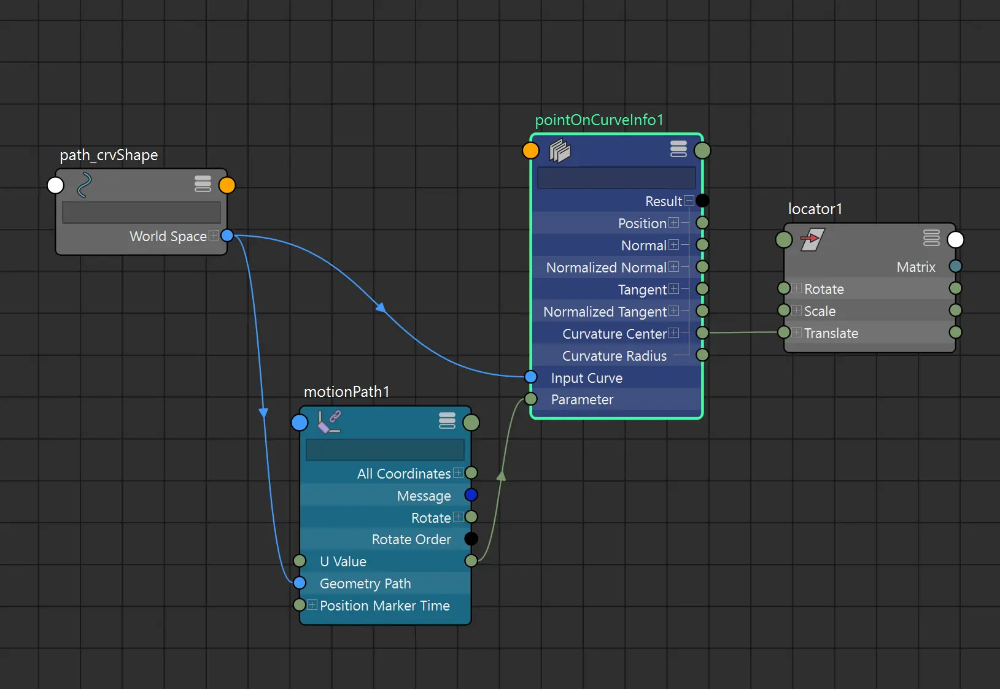

While looking into how to better animate vehicles, I came across [this](https://web.archive.org/web/20261104165714/https://en.etudes.ru/etudes/steering-geometry/) interesting study from the Steklov Mathematical Institute of Russian Academy of Sciences.

Let's break it down and see how we can replicate it in Maya!

---

## 1. Simple turn analysis

*Copyright [Mathematical Etudes Foundation](https://web.archive.org/web/20261104165714/https://en.etudes.ru/etudes/steering-geometry/)*

As shown here, a wheel always has its axis aiming to the center of the curve.

> Since the **rear wheels in most vehicles do not turn**, the center of the turn circle should lie on the continuation of the axis of these wheels.

As clearly explained, the rear wheels should be the pivot of the whole movement, not the middle of the car!

<video controls loop src="/blog/car-autopilot/rear-wheels.webm"></video>

*Copyright [Mathematical Etudes Foundation](https://web.archive.org/web/20261104165714/https://en.etudes.ru/etudes/steering-geometry/)*

### Let's do it in Maya

In Maya, we could use a **motion path** to have the car following the curve, but if we **offset** it so that **the rear wheels are the origin** of the motion path, we will immediately notice a **reduced drift** on the rear of the vehicle.

> [!NOTE]
> It's preferable to use an empty transform to offset the car, instead of moving the pivot. In the video I move the pivot only to keep the demo simple.

<video controls loop src="/blog/car-autopilot/motion-path.webm"></video>

<video autoplay loop muted playsinline src="/blog/car-autopilot/drift-difference.webm"></video>

*Notice the drift difference in the rear of the vehicle*

---

## 2. Front wheels steering

From the article:
> The front wheels must be turned so that the continuation of the axis of each wheel looks into the same center. And so, for good manageability **the front wheels must be turned to different angles**, and they will be unparallel!

That's what the [Ackermann steering geometry](https://en.wikipedia.org/wiki/Ackermann_steering_geometry) is about.

*Copyright [Mathematical Etudes Foundation](https://web.archive.org/web/20261104165714/https://en.etudes.ru/etudes/steering-geometry/)*

### How do we find the curve center?

Until now, we were just considering perfect circles. But as the study notes, <mark>on any road, at any turn and at any moment it is possible to consider that the car goes along the arc of some circle</mark>.

Given three points, it's possible to find the [circumcircle](https://en.wikipedia.org/wiki/Circumcircle), that is **a circle that passes through all three points**. We can put those points on the curve and notice how, by **moving them closer** until they almost coincide, we will obtain the **[osculating circle](https://en.wikipedia.org/wiki/Osculating_circle) of the curve**.

The center of that circle is where our front wheels' axes should aim to.

<video controls loop src="/blog/car-autopilot/tangent-circle.webm"></video>

*Copyright [Mathematical Etudes Foundation](https://web.archive.org/web/20261104165714/https://en.etudes.ru/etudes/steering-geometry/)*

### Let's visualize it in Maya

In Maya there is a node we can leverage for this: the `makeThreePointCircularArc`.
I'll create a 3 joints chain, and attach it to the curve using an `IK Spline`, then move the joints closer together.

> [!WARNING]
> Making the joints coincide, or sit too close, breaks the `makeThreePointCircularArc`, resulting in some ugly glitches.
> You can already get nice results with a distance of about 0.1 units.

We can parent a locator under each joint, and connect their `worldPosition[0]` to the `makeThreePointCircularArc` inputs. We will finally obtain the osculating circle.

<video controls loop src="/blog/car-autopilot/tangent-circle-maya.webm"></video>

Even though the `makeThreePointCircularArc` node outputs the circle center, we can simplify the setup using the `pointOnCurveInfo` node, that gives the same result without the need of any additional joint or locator nodes.

---

## 3. Final setup

We've already hooked the car to the spline via a `motionPath` node. We then add a `pointOnCurveInfo` node and connect the `uValue` from the motion path to it.

We will then connect the `curvatureCenter` to an empty transform, and use that transform to aim the wheel.

> [!TIP]
> It's better to use the transform as an up vector, this way we avoid having the wheels "break" from their lodging.

<video controls loop src="/blog/car-autopilot/final-setup.webm"></video>

And here we have a final car setup that follows a road curve with all the correct steering geometry.

<video autoplay loop muted playsinline src="/blog/car-autopilot/result.webm"></video>

> [!NOTE]
> Keep in mind that you will need to reverse the aiming based on the side of the circumcircle center. You could use the dot product to do so.