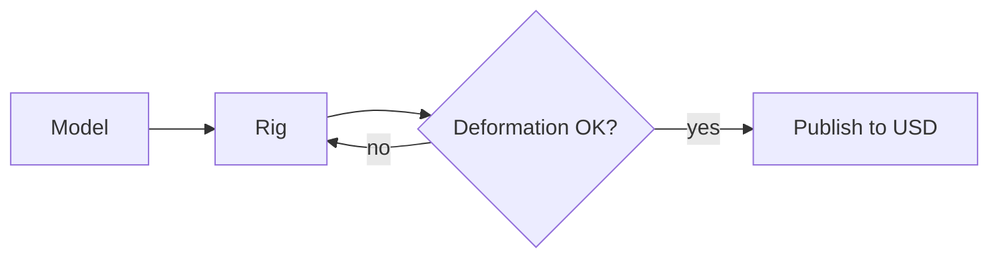
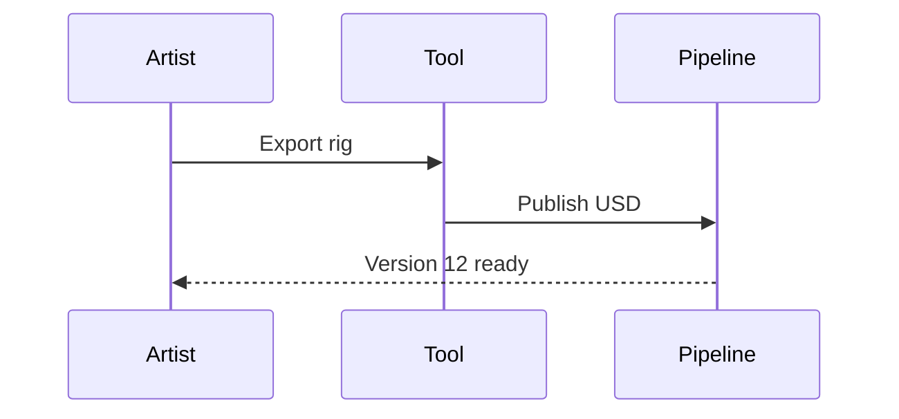
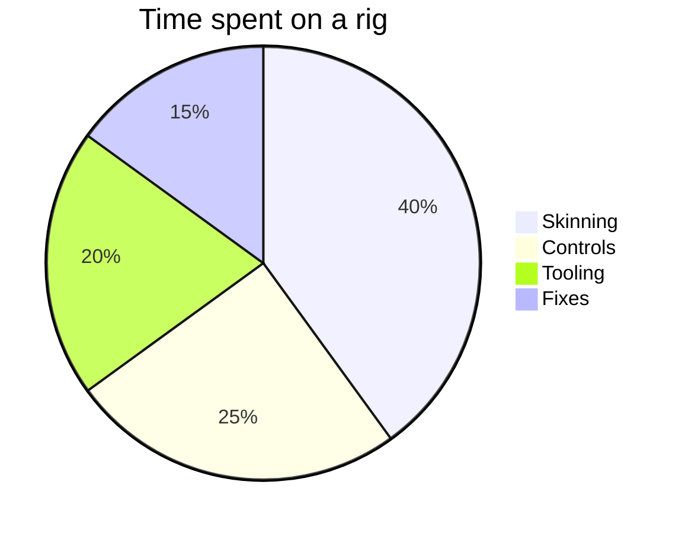
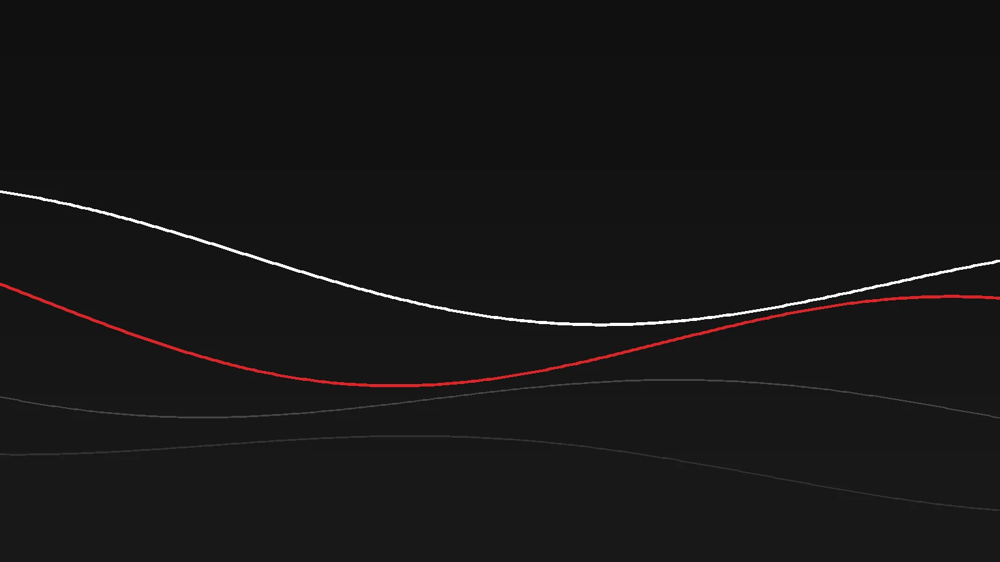

---
# ================= FRONT MATTER (the block between the --- lines) =================
# SEO: keep the title under about 60 characters and say what the post is about.
title: Formatting guide
# One sentence, shown when hovering the tile, in Google results and in link previews.
# SEO: 120-155 characters, written for a person, with the main topic in the first words.
description: Every formatting option available in a post, ready to copy.
date: 2026-11-04
# The tile image is NOT taken from the text: it is the cover below. Without a cover the tile
# shows a plain dark gradient. Best: a landscape image, about 4:3 (the tile crops it to fit).
# Cover image next to this file, shown on the tile and at the top of the post (optional):
# cover: ./cover.webp
# coverAlt: What the image shows (SEO: describe it, it is read by search engines and screen readers)
# Every tag becomes a link to a page listing all the posts with that tag.
tags: [Guide, Markdown]
# true = shown in the "Featured work" row of the home page (max 3).
# featured: true
# Turns the tile into a link to another page (Gumroad, LinkedIn, Vimeo...):
# externalUrl: https://example.com
# externalLabel: Get it on Gumroad
# The table of contents is automatic: it lists the ## and ### headings. Set toc: false to hide it.
# toc: false
# true = only visible in `npm run dev`, never published. Set it to false to publish.
draft: true
# true = the page exists but is left out of the lists (home, blog, tags).
unlisted: true
---

<!--
  HOW TO USE THIS FILE
  1. Copy the whole folder (src/content/blog/formatting-guide) and rename it: the folder name is the URL.
  2. Edit the front matter above, delete what you don't need.
  3. Text written between the comment marks (like this block) is invisible on the page.
-->

This is a normal paragraph. You can write **bold**, *italic*, ***bold italic***, ~~strikethrough~~, `inline code`, and [a link](https://example.com). Paragraphs are separated by an empty line.

## The preview tile

<!-- Explains how the tile on the home page and on the Blog page is built. -->

Every post is shown as a tile on the home page, on the Blog page and on the tag pages. The tile is built only from the front matter at the top of this file, never from the text of the post:

| On the tile            | Comes from                                   |
| :--------------------- | :------------------------------------------- |
| Background image       | `cover` (without it, a dark gradient)        |
| Title, with red line   | `title`                                      |
| Text shown on hover    | `description`                                |
| Link                   | the folder name of the post                  |

The first image in the text is **not** used: only `cover` is. Which posts reach the home page:

- **Featured work** row: up to 3 posts with `featured: true`, newest first.
- **Latest posts** row: the 3 newest posts that are not featured.
- The Blog page lists all of them, and each tag has its own page.

Posts with `unlisted: true` never appear on tiles. Drafts (`draft: true`) are not published at all; in `npm run dev` they show up with a red "Draft" label.

<!-- ## = section title, ### = subsection title. The post title (h1) comes from the front matter. -->

## Headings

### A subsection

#### A smaller one

## Lists

<!-- "-" for bullets, "1." for numbers. Indent with 2 spaces for nested items. -->

- First point
- Second point
  - A nested point
  - Another nested point
- Third point

1. First step
2. Second step
3. Third step

<!-- Task lists: "[ ]" is open, "[x]" is done. -->

- [x] Rig the arm
- [x] Skin the hand
- [ ] Write the blog post

## Banners

<!-- Five types: NOTE, TIP, IMPORTANT, WARNING, CAUTION. Every line of the banner starts with ">".
     Text after the type becomes a custom title, for example: > [!TIP] Faster way -->

> [!NOTE]
> Useful information that readers should know, even when skimming.

> [!TIP]
> Helpful advice to do something better or more easily.

> [!IMPORTANT]
> Key information users need to achieve their goal.

> [!WARNING]
> Urgent information that needs immediate attention to avoid problems.

> [!CAUTION]
> Advises about risks or negative outcomes of certain actions.

> [!TIP] A banner with a custom title
> It can contain **formatting**, `code` and [links](https://example.com) too.

## Quotes

<!-- A plain ">" without a type is a quote. -->

> Rigging is the art of making things move the way the animator imagines them.

## Tables

<!-- Columns are separated by "|". The ":" in the second row sets the alignment. -->

| Tool            | Language | Used for              |  Rating |
| :-------------- | :------- | :-------------------- | ------: |
| Catenary rig    | Python   | Dynamic curves        |     9/10 |
| Car autopilot   | Python   | Ackermann steering    |     8/10 |
| USD converter   | Python   | Pipeline              |     9/10 |

## Code

<!-- Three backticks and the language name give coloured code. Works for python, js, ts, json, bash, c, cpp, glsl, html, css, yaml... -->

```python
import maya.cmds as cmds


def create_locator(name, position=(0, 0, 0)):
    """Create a locator and move it to a position."""
    loc = cmds.spaceLocator(name=name)[0]
    cmds.xform(loc, translation=position, worldSpace=True)
    return loc
```

```json
{
  "name": "kevinrosso.me",
  "private": true
}
```

```bash
npm run dev
```

<!-- Code without a language is shown as plain text. -->

```
plain text, no colours
```

## Maths

<!-- Inline formulas go between single dollar signs, big centred ones between double dollar signs.
     To write a real dollar sign, type \$ -->

Inline formula: the catenary is $y = a \cosh\left(\frac{x}{a}\right)$ and the area of a circle is $\pi r^2$.

Centred formula:

$$
\vec{v}' = R\,\vec{v} + \vec{t}
\qquad
R = \begin{pmatrix} \cos\theta & -\sin\theta \\ \sin\theta & \cos\theta \end{pmatrix}
$$

Linear blend skinning:

$$
\mathbf{v}'_i = \sum_{j=1}^{n} w_{ij}\, \mathbf{M}_j\, \mathbf{M}_j^{-1}\, \mathbf{v}_i
\quad \text{with} \quad \sum_{j} w_{ij} = 1
$$

## Graphs

<!-- Three backticks and the word "mermaid". Full syntax: https://mermaid.js.org -->







## Images and video

<!-- Put the image in the same folder as this file and use "./name". It is resized and optimised
     automatically. The text between [ ] is the description for screen readers.
     A line in italics right after the image, separated by an empty line, becomes its caption. -->



*Caption under the image: just a line in italics after it.*

<!-- Videos from YouTube or Vimeo: paste the player address (the "embed" address) of the video.
     Vimeo looks like https://player.vimeo.com/video/123456789 -->

<iframe src="https://www.youtube-nocookie.com/embed/aqz-KE-bpKQ" title="Big Buck Bunny (Blender Foundation)" allow="fullscreen; picture-in-picture" loading="lazy"></iframe>

*A YouTube video. Replace the code after /embed/ with the ID of your video.*

A video file of your own: put it in the "public/videos" folder of the project and write

```html
<video controls src="/videos/my-clip.mp4"></video>
```

You could add `autoplay loop muted playsinline` instead of `control`s` for a looping animation.

### Captions

<!-- A caption is a line in italics, with an empty line between the image and the caption.
     It is centred under the image in smaller, grey type. -->


*Figure 1: a caption under a single image.*

## Inline images

<!-- Put the image inside <span class="inline-img"> and </span> in the middle of a sentence.
     It takes the height of the text and the words stay on the same line. -->

Here is a small image <span class="inline-img"></span> sitting inside a sentence, with the text kept on the same line.

## Floating images

<!-- <div class="float-right"> (or "float-left") around an image and its caption. The text flows
     around the figure. Put an empty line after the opening and before the closing tag.
     On phones the figure goes full width above the text. -->

<div class="float-right">


*A floated figure: the text runs around it on the left.*

</div>

The paragraph keeps going after the figure. The text wraps around the image while the figure is beside it. Use a floated figure for a picture that supports the text next to it, not for one that needs the full width.

This paragraph is the second one, and it also wraps around the figure while it stays beside it.

## Columns

<!-- <div class="columns-2"> or <div class="columns-3">, with one <div> per column. Each column
     can hold any formatting, images and captions included. On phones the columns stack. -->

<div class="columns-2">

<div>

**Left column.** Text can use any formatting, lists included:

- A point
- Another point

</div>

<div>


*Caption for the image in the right column.*

</div>

</div>

Three columns work the same way, with `class="columns-3"`:

<div class="columns-3">

<div>

**One.** Short text in the first column.

</div>

<div>

**Two.** Short text in the second column.

</div>

<div>

**Three.** Short text in the third column.

</div>

</div>

## Buttons

<!-- Plain HTML links with the class "btn" (outlined) or "btn btn--solid" (filled).
     Put several in one <p class="buttons"> to line them up. -->

<p class="buttons">
  <a class="btn btn--solid" href="https://kevinrosso.gumroad.com/l/catenary" target="_blank" rel="noopener">Get it on Gumroad &rarr;</a>
  <a class="btn" href="/blog/">All posts</a>
  <a class="btn" href="https://github.com/vinRosso" target="_blank" rel="noopener">View the code</a>
</p>

A single button on its own line:

<p><a class="btn btn--solid" href="/#about">Back to the About section</a></p>

## Horizontal lines

<!-- Three dashes on their own line draw a line. Use <hr class="..."> for the variants. -->

A normal line (three dashes):

---

A short red line, to separate big parts:

<hr class="accent" />

A thick line:

<hr class="thick" />

A dotted line:

<hr class="dots" />

## Spacing

<!-- Extra empty lines in Markdown are ignored. To add space, use a spacer:
     <div class="space-sm"></div>  small (1 rem)
     <div class="space"></div>     medium (2.5 rem)
     <div class="space-lg"></div>  large (5 rem) -->

Text before a small spacer.

<div class="space-sm"></div>

Text after a small spacer.

<div class="space"></div>

Text after a medium spacer.

<div class="space-lg"></div>

Text after a large spacer.

## Links

<!-- [text](address). Addresses starting with "/" stay inside the site. "#name" jumps to a heading of
     the same post: the name is the heading in lowercase with dashes ("Images and video" -> #images-and-video). -->

- To another website: [Astro documentation](https://docs.astro.build)
- To a section of this post: [jump to the maths](#maths) or [jump to the tables](#tables)
- To a precise point that is not a heading: [jump to the sentence at the end of this section](#my-anchor). See below for how to make the target.
- To another post: [KR Catenary](/blog/kr-catenary/)
- To a section of another post: [the formatting guide, banners](/blog/formatting-guide/#banners)
- To a page of the site: [the About section](/#about), [all posts](/blog/), [posts tagged Python](/blog/tag/python/)
- To an email address: [write to me](mailto:name@example.com)

<!-- Any spot can be a link target: put an empty <span id="name"></span> where the page should land
     (here, at the start of the sentence below), then link to it with [text](#name). Use lowercase
     letters and dashes, and a name no heading already uses. For another post: [text](/blog/post-name/#name). -->

<span id="my-anchor"></span>This sentence is the target of the "precise point" link above: the page scrolls here, even though it is not a heading.

## Small extras

<!-- Plain HTML works inside the post. -->

Highlighted text: <mark>this is important</mark>. Keys: press <kbd>Ctrl</kbd> + <kbd>Shift</kbd> + <kbd>B</kbd>. Chemistry and powers: H<sub>2</sub>O and x<sup>2</sup>.

Footnotes are collected at the end of the post.[^1] You can add as many as you like.[^2]

[^1]: This is the first footnote.
[^2]: And this is the second one.

<details>
<summary>A collapsible block (click to open)</summary>

Good for long logs, extra details or spoilers. It can contain **any** formatting, even code:

```python
print("hidden until opened")
```

</details>

---

<!-- Three dashes on their own line draw a horizontal line, like the one above. -->

That is everything. Delete the sections you don't need and write your post.
